<picture>
  <source media="(prefers-color-scheme: dark)" srcset="assets/header-dark.svg">
  
</picture>

  <a href="https://abirchebbi-portfolio.vercel.app/">Portfolio</a> ·
  <a href="https://www.linkedin.com/in/abir-chebbi/">LinkedIn</a>

### What I do now

AI Tech Lead at **DI Xpertia**, where I work across several applied-AI products.

**Tech lead — meeting transcription & analysis SaaS.** I lead the product end to end: it turns meeting recordings into searchable transcripts and structured analysis, from the audio pipeline to the database, the UI and the deployment.

**Contributor — other AI projects.** I also take part in the company's work on **retrieval-augmented generation (RAG)**, **LLM applications** and **document OCR**.

What that looks like in practice:

- **Speech & LLM pipelines** — speech recognition (Whisper family), speaker diarization and language models **hosted on our own infrastructure**, with evaluation before every model change.
- **Data isolation by design** — PostgreSQL Row-Level Security enforced in the database, covered by an automated **pgTAP** test suite that runs in CI.
- **Privacy-first AI** — data minimisation and short-lived processing of sensitive data, with GDPR in mind from the schema up.
- **Shipping & operating** — FastAPI services, a React/TypeScript front end, Docker images deployed with Dokploy, staged releases and incident handling.

### How I build

- **Evaluate before you ship** — no model, prompt or pipeline change goes out without a measured comparison.
- **Enforce isolation in the database** — access rules live where the data lives, and are tested like code.
- **Privacy by default** — collect less, keep it shorter, delete it provably.
- **Boring deployments** — small releases, staging first, a rollback ready before every change.

### Toolbox

<picture>
  <source media="(prefers-color-scheme: dark)" srcset="assets/stack-dark.svg">
  
</picture>

### My year, as a waveform

<picture>
  <source media="(prefers-color-scheme: dark)" srcset="assets/waveform-dark.svg">
  
</picture>

Most of my day-to-day work lives in private repositories: the activity is real, the code is not public.

### Now

<!-- NOW:START -->
**Building in public.** Open-source tools around LLM evaluation, speech AI and PostgreSQL security — first release coming soon.
<!-- NOW:END -->
